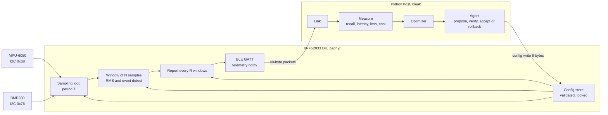
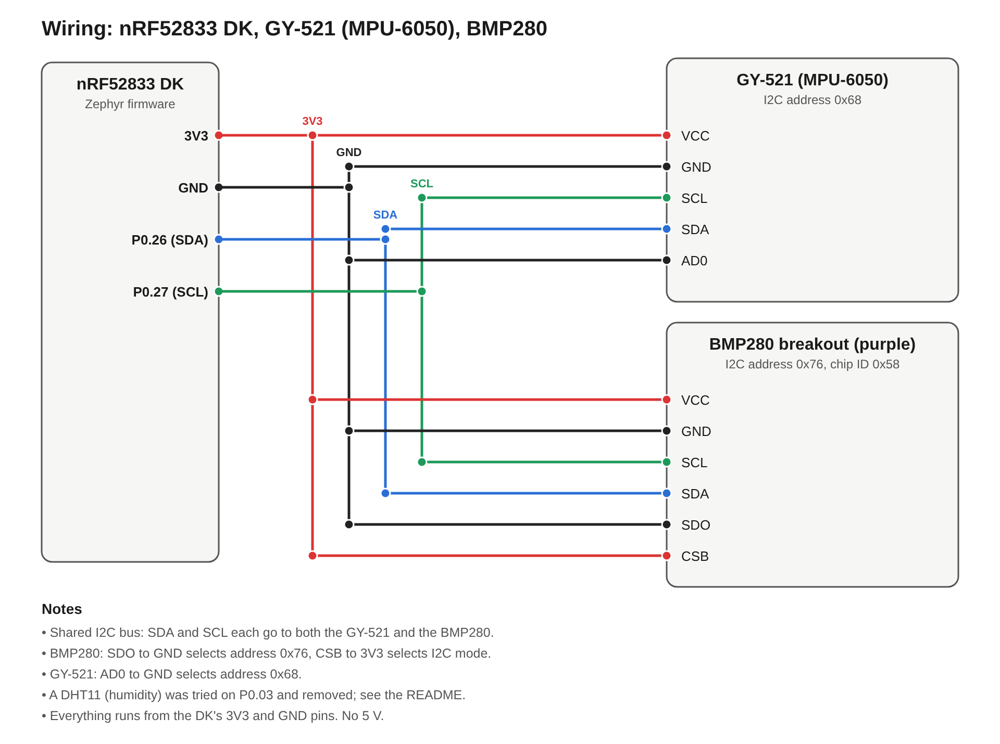
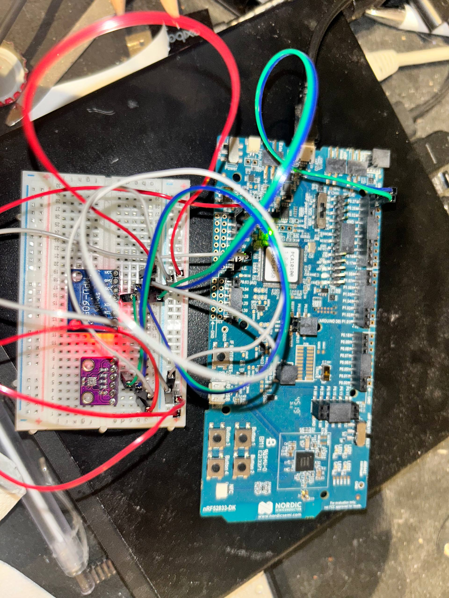
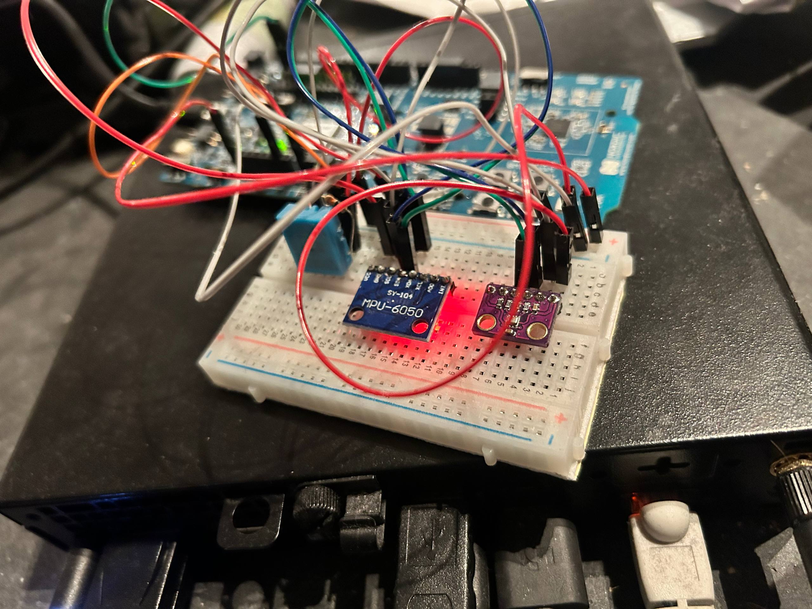
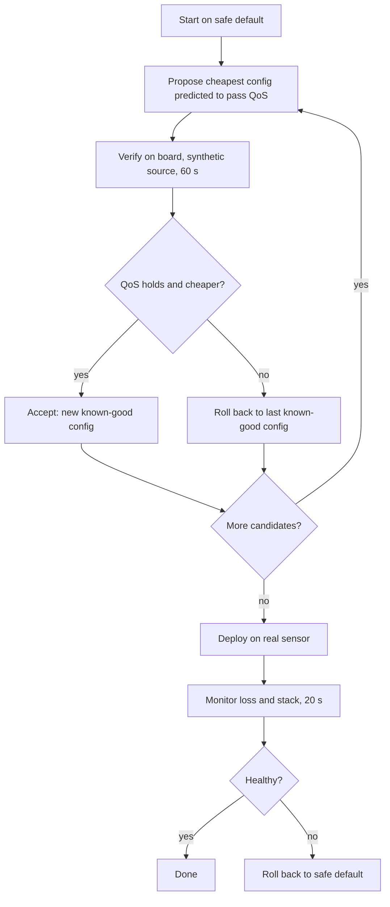
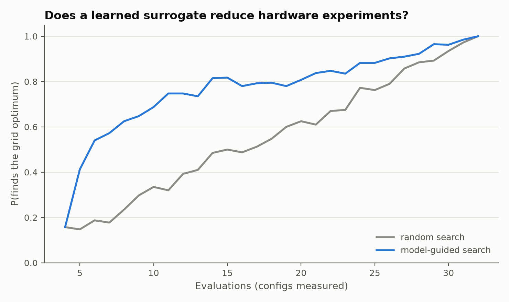
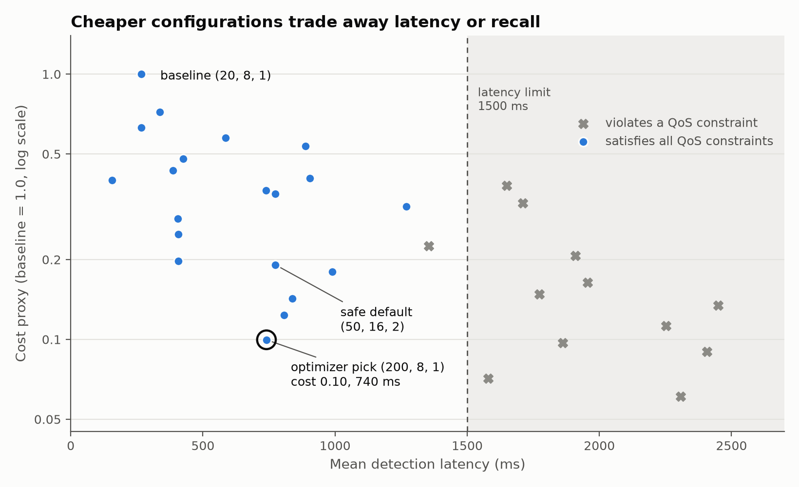
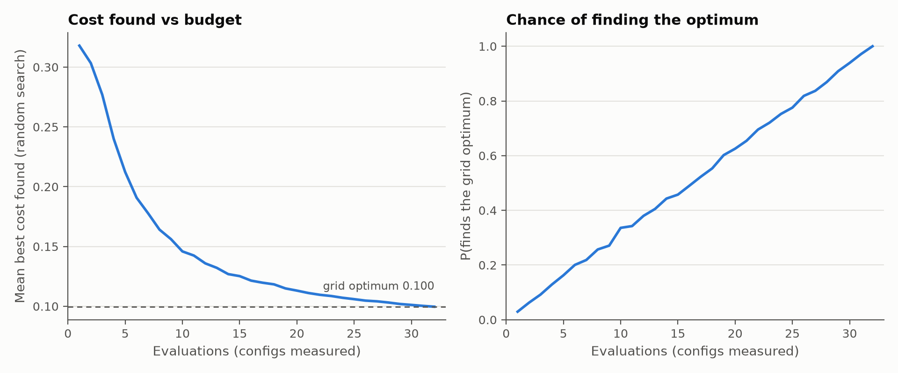
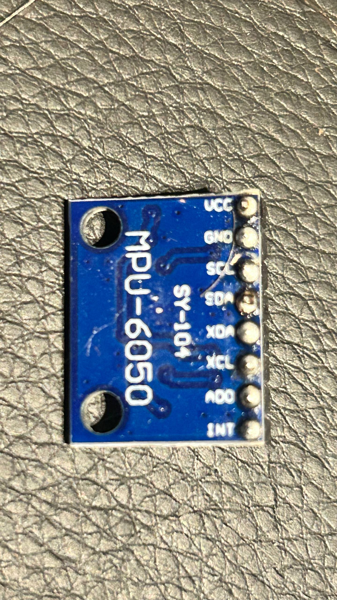

# Autonomous Edge Runtime Optimizer
DTEK8146 Embedded System Design, University of Turku. Solo project by Roosa Yöruusu.

An nRF52833 DK running Zephyr (nRF Connect SDK v3.3.4) senses motion with an MPU-6050
accelerometer (GY-521 board), detects motion events, and streams telemetry over BLE.
A BMP280 on the same I2C bus adds temperature and pressure to the telemetry.
A Python host changes the device's runtime configuration over BLE, measures what each
configuration costs and what quality of service (QoS) it delivers, finds the cheapest
configuration that still meets the QoS constraints, verifies it on the device, and rolls
back to a safe default if verification fails.

**Result in one line:** across 32 measured configurations, the optimizer picks
(T=200 ms, N=8, R=1), which has about 90 % lower proxy cost than the baseline and about
48 % lower than the safe default, while meeting every QoS constraint.
Cost is a proxy (loop active time and BLE packet rate). It is **not** a power measurement.
See [Limitations](#limitations-and-honest-caveats).

## Contents
1. [System overview](#system-overview)
2. [Repository layout](#repository-layout)
3. [Hardware](#hardware)
4. [Reproduce it step by step](#reproduce-it-step-by-step)
5. [Firmware design](#firmware-design)
6. [Measurement model](#measurement-model)
7. [Optimizer, verification and rollback](#optimizer-verification-and-rollback)
8. [Results](#results)
9. [Limitations and honest caveats](#limitations-and-honest-caveats)
10. [Phase map](#phase-map)
11. [My contribution](#my-contribution)
12. [Soldering part](#soldering-part)

## System overview


The three runtime parameters the host can change:

| Parameter | Meaning | Allowed values (device-validated) |
|---|---|---|
| T | sample period (ms) | 20 to 5000 |
| N | window length (samples) | 8 to 64 |
| R | report every R windows | 1 to 10 |
| source | 0 = real sensor, 1 = synthetic event source | 0 or 1 |

The device rejects invalid writes with `BT_ATT_ERR_VALUE_NOT_ALLOWED` and keeps the old
configuration (checked, for example R=0).

## Repository layout
```
firmware/                Zephyr application (nRF52833 DK)
  prj.conf
  src/main.c             sampling loop, windowing, event detection, telemetry
  src/config/            runtime config, validation, spinlock-protected get/set
  src/ble/               GATT service: telemetry notify, config read/write
  src/sensors/           MPU-6050 read, synthetic event source, BMP280 read (env.c)
hardware/
  wiring.svg, wiring.png wiring diagram (DK, GY-521, BMP280)
host/
  src/ble_client.py      manual BLE test client (config write, rejection test)
  src/experiment.py      measurement model, automated experiment runner, grid and random search
  src/optimize.py        optimizer, search comparison, verify and rollback
  src/agent.py           closed-loop agent: propose, verify, accept or rollback, health monitor
  src/learn.py           Phase 6: surrogate model and model-guided search (replayed on measured data)
  src/plots.py           figures and results table
  src/watch.py           real-sensor sanity check
  results/               experiments.csv, agent_log.jsonl, optimizer_summary.json,
                         learning_summary.json, results_table.md, real_sensor_check.txt, figures/
```

## Hardware
| Part | Use |
|---|---|
| nRF52833 DK | MCU board, BLE, J-Link on-board debugger |
| GY-521 (MPU-6050 clone) | accelerometer, I2C address 0x68 |
| BMP280 breakout | temperature and pressure, I2C address 0x76 (chip ID 0x58 confirmed by the boot-time I2C scan) |
| Breadboard and jumper wires | all connections; everything runs from the DK's 3V3 and GND |



| Signal | DK pin | GY-521 | BMP280 |
|---|---|---|---|
| 3V3 | 3V3 | VCC | VCC and CSB |
| GND | GND | GND and AD0 | GND and SDO |
| SDA | P0.26 | SDA | SDA |
| SCL | P0.27 | SCL | SCL |

SDO to GND sets the BMP280 address to 0x76; CSB to 3V3 selects I2C mode. AD0 to GND sets the GY-521 address to 0x68.

**Real setup:** the GY-521 and the BMP280 on the breadboard, wired to the DK as in the diagram above.




**Sensor notes.**
* The purple breakout was bought as a BME280 but is a **BMP280**: its chip ID is 0x58 (a BME280 reports 0x60).
  The BMP280 has no humidity sensor, so the `hum_c100` field of the telemetry packet is always 0.
  The Zephyr `bosch,bme280` driver also supports the BMP280.
* **DHT11 (humidity), not delivered.** I wired a DHT11 on P0.03 with a 10 kΩ pull-up. Every read failed
  with `-5` (EIO), and later, when its VCC pin was connected, the board's 3V3 supply collapsed. I did not isolate
  the cause (possibly damage from an early wiring mistake), judged the part unusable, removed it and its driver
  code, and kept the packet layout (two reserved fields). Humidity is therefore not measured.

## Reproduce it step by step
Tested on Linux with nRF Connect SDK v3.3.4 at `~/ncs`.

### 1. Build and flash the firmware
```bash
python3 -m venv ~/zephyr-venv && source ~/zephyr-venv/bin/activate
export ZEPHYR_BASE=~/ncs/zephyr          # NCS v3.3.4 toolchain assumed installed
cd firmware
west build -b nrf52833dk/nrf52833 .      # must be run inside firmware/
west flash --dev-id <your J-Link serial>
```

Optional serial log:
```bash
picocom -b 115200 /dev/serial/by-id/usb-SEGGER_J-Link_*-if00
```

The board starts on the safe default (T=50, N=16, R=2, real sensor) and advertises over BLE.

### 2. Set up the host
```bash
cd host/src
python3 -m venv venv && source venv/bin/activate
pip install bleak matplotlib numpy
```

Set your board's BLE address in `experiment.py` (`ADDRESS`; the value in the repo is mine).
Only one BLE connection to the board is possible at a time: close other scripts first.

### 3. Run the experiments
```bash
python3 ble_client.py                 # smoke test: config write, rejection, restore
python3 experiment.py baseline        # baseline and safe default
python3 experiment.py grid 60         # all 32 pruned configs, 60 s each (about 35 min in total)
python3 experiment.py random 8        # random search comparison
python3 experiment.py one 50 8 5 60   # re-measure a single config
python3 experiment.py show            # print results/experiments.csv
```

The committed grid results used 60 s per config (11 to 12 injected bursts each). The baseline and safe default
were measured for about 20 s each (3 to 4 bursts), which is enough for their duty and packet rate (the cost
normalization) but too short for a meaningful recall estimate.

### 4. Optimize, verify, roll back
```bash
python3 optimize.py                   # analyse results, rank configs, replay random search
python3 optimize.py deploy 120        # verify the best config for 120 s
python3 optimize.py rollback-demo 60  # deliberately deploy a failing config, watch rollback
python3 agent.py --dry-run            # replay agent logic on the measured table (no board)
python3 agent.py                      # closed loop on the board
python3 agent.py --explore            # optimistic proposals: shows rollbacks happening
python3 learn.py                      # Phase 6: surrogate model vs random search (no board needed)
```

### 5. Figures and real-sensor check
```bash
python3 plots.py                      # writes results/figures/*.png and results/results_table.md
python3 watch.py 40                   # keep still 10 s, then shake the GY-521
```

## Firmware design
### Sampling and timing
* Sampling uses absolute deadlines (`k_sleep(K_TIMEOUT_ABS_MS(next))`, `next += T`),
  so the real period equals the configured period. An earlier `k_msleep` version
  drifted (820 ms instead of 800 ms).
* Processing time is measured with the DWT cycle counter (64 MHz, no FPU, integer math only).
* A config change flushes the current window, so a window never mixes two configurations.

### Event detection
Window RMS (about the window mean) is computed in integer math. An event is counted on a
rising edge across a 50 mg threshold. A single threshold counts every crossing; hysteresis
(for example start above 50, end below 30) would be a possible improvement and is not implemented.

Real-sensor values are uncalibrated mg. Measured on the board: about 2 to 6 mg at rest,
63 to 121 mg when shaken (see `host/results/real_sensor_check.txt`).

### Telemetry packet (48 bytes, little endian)
| Field | Type | Meaning |
|---|---|---|
| seq | u32 | packet counter, counts only packets sent while subscribed |
| uptime_ms | u32 | device uptime |
| rms_mg | u32 | window RMS |
| proc_us | u32 | processing time of the last window |
| events | u32 | cumulative event count |
| windows | u32 | cumulative window count |
| sent | u32 | notifications sent |
| notify_err | u32 | failed notifications |
| duty | u16 | loop active fraction in 0.01 % units (not CPU cycles) |
| stack_free | u16 | free stack bytes |
| period_ms | u16 | active sample period T |
| temp_c100 | i16 | BMP280 temperature, 0.01 degC (refreshed every 2 s) |
| hum_c100 | u16 | always 0 (BMP280 has no humidity) |
| press_dhpa | u16 | BMP280 pressure, 0.1 hPa |
| dht_temp_c100, dht_hum_c100 | i16, u16 | reserved, always 0 (DHT11 removed; kept so the layout did not change) |
| env_status | u16 | bit 0 = last BMP280 read succeeded |

Host format: `struct.Struct("<IIIIIIIHHHHhHHhHH")`. Config write: `struct.Struct("<HHHH")` = (T, N, R, source).

GATT UUIDs share the base `-4a1b-4c3d-8f00-0123456789ab`: service `e5a10001`,
telemetry notify `e5a10002`, config read/write `e5a10003`.

### Synthetic event source (ground truth)
With `source = 1` the firmware injects a burst at device uptime 5000 * k ms
(400 ms long, +200 mg, noise of plus or minus 5 mg). This gives the host a known ground truth
for recall and detection latency, independent of anyone shaking the board.

## Measurement model
Per configuration the host measures on the synthetic source, then computes:

| Metric | Definition |
|---|---|
| recall | min(detected, injected) / injected, with the injection window shifted back by the nominal delay D = T * N * R |
| detection latency | device uptime of the first packet showing a new event, modulo 5000 ms (valid while worst-case delay < 5000 ms, enforced by pruning R * N * T <= 4000 ms) |
| loss rate | missing sequence numbers / expected |
| duty | median loop active time per window (0.01 % units); see the limitation below |
| pps | BLE packets per second |
| stack | minimum free stack |

**Cost proxy** (baseline = 1.0; duty is loop active time, not CPU cycles): `0.5 * duty / duty_baseline + 0.5 * pps / pps_baseline`,
with baseline (T=20, N=8, R=1).

**QoS constraints:** recall >= 0.90, mean latency <= 1500 ms, loss <= 2 %, free stack >= 128 bytes.

**Search space:** T in {20, 50, 100, 200}, N in {8, 16, 32, 64}, R in {1, 2, 5, 10},
pruned to 32 configs. **Safe default:** (50, 16, 2).

## Optimizer, verification and rollback


* `optimize.py` selects the minimum-cost config subject to the hard QoS limits, and
  replays random search on the measured data to compare search budgets against the full grid.
* `agent.py --explore` also proposes near-miss configs (within 0.10 recall and 25 % latency
  of the limits) so that verification and rollback actually happen.
* Every decision is logged to `host/results/agent_log.jsonl`.

## Learning-based search (Phase 6)
`host/src/learn.py` asks: can a model fitted on a few measured configurations choose the next one to measure,
so that the optimum is found with fewer board experiments than random search?

* **Model:** ridge regression (numpy only) from engineered features of (T, N, R)
  (`1000/T`, `1000/(T*N)`, `1000/(T*N*R)`, `T*N*R/1000`, `T*N/1000`) to cost, mean latency and recall.
* **Guided search:** measure 4 random configs, fit, then repeatedly measure the config with the lowest
  predicted cost among those predicted to be safe (predicted latency at most 85 % of the limit, predicted recall at least 0.95).
* **Evaluation:** replayed on the 32 measured configs, 400 random seeds, no extra board time.

Leave-one-out error of the model on the full grid: cost 0.005, mean latency 112 ms, recall 0.08.

| Configs measured | Random search finds the optimum | Guided search finds the optimum |
|---|---|---|
| 6 | 19 % | 54 % |
| 8 | 23 % | 62 % |
| 12 | 39 % | 75 % |
| 20 | 62 % | 81 % |
| 32 (all) | 100 % | 100 % |



Reading this honestly: the model predicts cost almost exactly and latency reasonably, but it predicts recall
poorly (recall is nearly binary and depends on burst aliasing), which is why the search uses safety margins
instead of trusting it. The optimum (200, 8, 1) sits in a corner of the grid, where cost falls steadily, so
this is an easy landscape for a simple model. The result is a replay on 32 points, not a live experiment, and it
shows that fewer measurements suffice on this grid, not that the same holds on another one.

## Results
20 of 32 measured configurations satisfy all QoS constraints.

| Config (T, N, R) | Cost | Recall | Mean latency (ms) | Note |
|---|---|---|---|---|
| (20, 8, 1) | 1.000 | 1.00 | 267 | baseline |
| (50, 16, 2) | 0.191 | 1.00 | 773 | safe default |
| (50, 32, 1) | 0.180 | 1.00 | see results_table.md | feasible |
| (100, 8, 2) | 0.142 | 1.00 | 839 | feasible |
| (100, 16, 1) | 0.124 | 1.00 | 807 | feasible |
| **(200, 8, 1)** | **0.100** | **1.00** | **740 (grid)** | **optimizer pick** |

Full ranked table: [`host/results/results_table.md`](host/results/results_table.md).
Raw data: [`host/results/experiments.csv`](host/results/experiments.csv).





**Repeated measurements of the pick (200, 8, 1):** mean latency 674, 740, 857, 874, 677 and 856 ms across
six runs (grid, 120 s verify, three agent runs, one 60 s re-measure). All meet the 1500 ms limit with margin, but the
spread (about 200 ms) is the honest uncertainty of the estimate.

**Verification and rollback (board runs):**
* `optimize.py rollback-demo`: (200, 16, 1) violated QoS and was rolled back to (50, 16, 2).
* `agent.py --explore`: (200, 8, 2) measured 1810 ms (limit 1500) and (100, 16, 2) measured
  1801 ms. Both were rejected and rolled back. (200, 8, 1) was then verified (recall 1.00,
  674 ms, loss 0) and accepted, deployed on the real sensor, and passed the health monitor
  (loss 0, stack 1392 bytes free).
* **Re-run after the BMP280 firmware change (25 Oct):** the baseline measured duty 295 and the pick
  (200, 8, 1) duty 29, mean latency 677 ms, loss 0, so adding the BMP280 read did not change the results.
  `agent.py --explore` again rejected (200, 8, 2) at 1726 ms and (100, 16, 2) at 1692 ms and accepted
  (200, 8, 1) (recall 0.917, 856 ms, loss 0). Free stack was 1360 bytes, 32 bytes lower than before,
  which is the BMP280 driver call depth. A recall of 0.917 is 11 of 12 bursts, a pass with little margin
  (see the recall quantization limitation).

**Real-sensor check:** with (200, 8, 1) deployed on the real sensor, rms was 3 to 6 mg at rest
and 63 to 121 mg during a shake, and the event counter rose by one for that shake
(`host/results/real_sensor_check.txt`).

## Limitations and honest caveats
* **Cost is a proxy.** No power-measurement hardware was available. Cost combines loop active
  time and BLE packet rate with equal weights. It says nothing about milliamps or energy.
* **Duty is loop active time, not CPU cycles.** The measured time includes blocking I2C waits and UART
  `printf` output, so it overstates real compute time and depends on the logging.
* **Ground truth is synthetic.** Recall and latency are measured against one burst pattern
  (400 ms, +200 mg, every 5 s). Other motion patterns may behave differently.
* **Latency is device-side.** It is measured from device uptime, so BLE transport delay is excluded.
* **Recall is coarse.** With 60 s runs the estimator has a quantization of about 1/12.
* **Measurement noise.** Repeated runs of the same config vary (see (200, 8, 1) above).
  One grid entry, (50, 8, 5), measured recall 0.42 once and recall 1.00 on re-measurement.
  A probable cause, not tested: for (50, 8, R) the window length T*N is 400 ms, equal to the burst
  length, so whether a window lands inside the burst depends on phase. It does not affect the selection.
* **Event counting can double count.** Small windows can see both the rising and the falling edge of
  one burst as separate events. Recall is count-based, min(detected, injected) / injected, which caps and
  can hide double counting.
* **Single threshold detector.** No hysteresis, so a signal hovering around 50 mg can count extra events.
* **One real-sensor test.** Real motion detection was verified with one shake episode, not a statistical test.
* **No humidity sensing.** The BMP280 has no humidity channel and the DHT11 did not work (see Hardware).
* **Temperature and pressure are logged, not used.** The BMP280 values travel in the telemetry but the
  optimizer does not use them.
* **The learning model is small and offline.** It is a ridge regression replayed on 32 measured points
  (see Learning-based search). The deployed agent is still the rule-based loop; it does not call the model.

## Deviations from the proposal
The proposal (1 Oct 2026) and the roadmap describe an "environmental and motion" telemetry node
with a staged path to a learning-based optimizer and an autonomous agent. What was delivered:

| Proposal item | Status |
|---|---|
| Zephyr telemetry node on nRF52833, BLE telemetry | done |
| Runtime configuration without reflashing | done (T, N, R, source) |
| Measurement and QoS model | done, with a proxy cost instead of power |
| Automated experiments, grid and random search | done |
| Deterministic optimizer | done |
| Safety: validation, rollback, safe default | done |
| Autonomous agent with verify and rollback | done (rule-based loop over measured data, no LLM) |
| Temperature sensing | done: BMP280 temperature and pressure in the telemetry |
| Humidity sensing | **not delivered**: the BMP280 has no humidity channel, and the DHT11 did not work |
| Lightweight learning-based optimizer (Phase 6) | done as an offline surrogate model with model-guided search, replayed on measured data; not used by the deployed agent |
| Memory-headroom metric | done as free stack bytes |
| Power or energy measurement | **not possible**, no power hardware; cost is a proxy |

## Phase map
| Phase | Topic | Where |
|---|---|---|
| 0 | Environment and hardware | `firmware/prj.conf`, this README |
| 1 | Embedded baseline (sampling, window RMS, events, telemetry, BMP280) | `firmware/src/main.c`, `firmware/src/sensors/` |
| 2 | Runtime configuration over BLE | `firmware/src/config/`, `firmware/src/ble/`, `host/src/ble_client.py` |
| 3 | Measurement model | `host/src/experiment.py` (`summarize`, `qos_ok`, `cost`) |
| 4 | Automated experimentation | `host/src/experiment.py` (`grid`, `random`, `one`) |
| 5 | Deterministic optimizer | `host/src/optimize.py` |
| 6 | Performance model and learning | `host/src/learn.py`, `host/results/learning_summary.json` |
| 7 | Autonomous agent | `host/src/agent.py` |
| 8 | Robustness and safety | validation on device, `verify`, rollback, health monitor |
| 9 | Evidence and evaluation | `host/results/`, `host/src/plots.py`, `host/src/watch.py` |
| 10 | Explanation and reporting | this README |

## My contribution
This was a solo project; all design, firmware, host software, experiments and documentation
are mine. AI assistance (Claude) was used throughout for code suggestions, review and drafting documentation.
The design decisions, hardware work, experiments and measurements are mine, and all results come
from my own board. Commit history does not mark AI-assisted changes individually.

## Soldering part
The soldering I was allowed to do was the **header pins of the GY-521 (MPU-6050) module**, and that is
the only soldering I did. The module's pins are soldered to a header so that it plugs into the breadboard
and connects to the nRF52833 DK with jumper wires. Everything else in this project is connected with
breadboard and jumper wires, with no other soldering.

f
